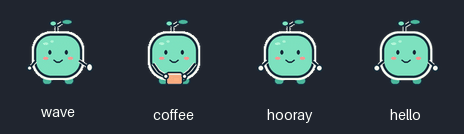
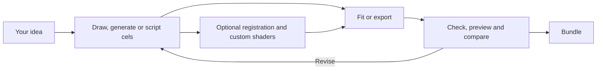

# Emoji Forge

Emoji Forge gives you and your agent tools to make and share custom emoji, stickers and reactions. Bring drawings or generate cels, write your own GLSL passes, or animate with a Python hook. Forge handles registration, export budgets, previews, and comparisons. You and your agent decide what to make.



[Still preview](examples/demo/preview.png) · [Example ZIP](examples/demo/pack.zip) · [Example source](examples/build.py)

## Install the skill

Clone this repository as `emoji-forge` in your agent's skills directory. Keep the directory together so the skill can find its scripts and references.

| Agent | Directory for the checkout |
| --- | --- |
| Claude Code | `~/.claude/skills/emoji-forge` or `.claude/skills/emoji-forge` in a project. |
| Codex | `~/.agents/skills/emoji-forge` or `.agents/skills/emoji-forge` in a project. |
| Other agents | Use the client's [Agent Skills](https://agentskills.io/) location, or point the agent to [SKILL.md](SKILL.md). |

See the [Claude Code skill docs](https://code.claude.com/docs/en/skills) and [Codex skill docs](https://developers.openai.com/codex/skills/). Install [uv](https://docs.astral.sh/uv/) to run the tooling. Plain raster commands use Pillow. Add `--extra gpu` to the `uv run` commands for ModernGL. For fallback, add `--extra webgl` and use installed Chrome with `--channel chrome`, or install Chromium with `uv run --extra webgl playwright install chromium`.

## Five-command loop

Start with the tools you need. This example uses a folder of cels and a shader you write. A pack manifest is useful when you want to reuse the same steps across several emoji.

```sh
uv run forge new my-emoji --no-manifest
# Sketch ideas together, draw cels into my-emoji/cels, and write my-emoji/glow.frag.
uv run --extra gpu forge all my-emoji/cels build/draft --preset slack --effect my-emoji/glow.frag --draft
uv run forge snapshot build/draft build/review
uv run --extra gpu forge all my-emoji/cels build/final --preset slack --effect my-emoji/glow.frag --json
uv run forge compare build/draft build/final build/comparison
```

The style and storyboard files are conversation prompts. Use them for sketches, links or whatever helps you iterate. Run any command on its own. For example, `forge fit cels/ wave.gif --preset slack` takes a folder and returns a sized GIF. The [tool reference](references/workflow.md) covers timing, optional manifests, Python hooks and all commands.

## How the tools fit together



## Examples

- [Sprout pack](examples/demo/) shows three animated reactions and one still. Rebuild it with `uv run --extra gpu python examples/build.py build/example`.
- [Custom animation and shader chain](examples/custom/) uses a Python function to draw the sequence and two original GLSL passes. See the [shader walkthrough](references/shaders.md) to write your own.

`forge all` can build multiple emoji in parallel and reuse cached renders. Add `--draft` to try an idea quickly and `--json` to read results programmatically. The [Slack reference](references/slack.md) describes its export targets. The generic preset and independent commands also work without Slack.

Run `uv run --extra gpu --extra test pytest -q` for the local test suite. To include WebGL, install Chrome and run with `--extra webgl` and `FORGE_TEST_CHROME=chrome`.

## Authors

- [Pablo Pazos](https://github.com/ppazosp)
- [Jorge Hermo](https://github.com/jorgehermo9) · [@jorgehermo9 on X](https://x.com/jorgehermo9)

[MIT license](LICENSE)
