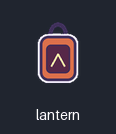

# A lantern with its own motion and glow

A Python hook draws the lantern cels, animates the filament and gives each exposure its own shader coordinate. The first custom pass lights an expanding ring around that coordinate. Bloom softens it. A second custom pass reads the first pass and tints the glow without recoloring the lantern.

```sh
uv run --extra gpu forge all examples/custom/pack.json build/lantern --allow-scripts
```

You can run the drawing hook on its own with `forge all examples/custom/draw.py build/cels` from the checkout. The manifest adds a custom curve, shader chain and Slack output budget. The drawing, effect and timing are editable examples.


