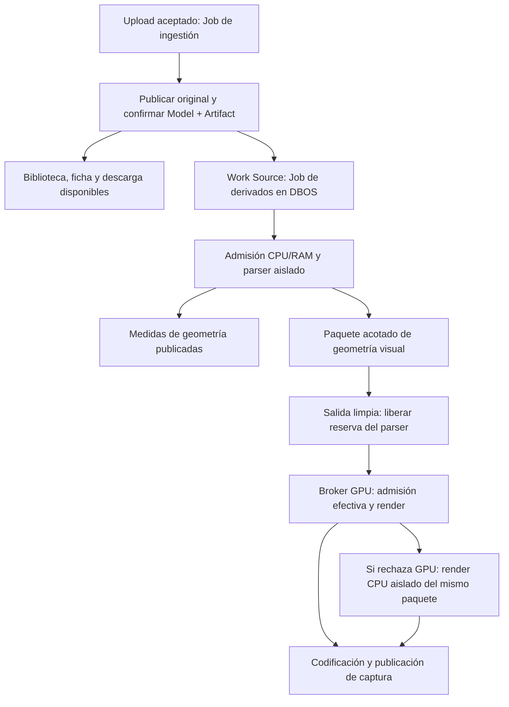

# Reporte final de auditoría del pipeline de ingestión — 13 de octubre de 2026

**Trabajo detenido por petición del usuario. No se ha demostrado una mejora sustancial del tiempo total.** La mejor variante experimental del lote de 200 modelos reduce el tiempo monotónico un 1,64%; las demás son más lentas que el control. No se presenta este resultado como una optimización global conseguida.

El código pendiente conserva las optimizaciones de llamadas, como pidió el usuario. Las últimas modificaciones no tienen validación de tests ni CI. No se ha realizado commit, push, actualización de PR ni despliegue de estos cambios. El cierre solo detiene ejecuciones y consolida evidencia ya obtenida.

Repositorio: `/home/local/PrintStash-gpu-ingestion`. Rama: `feat/transparent-gpu-ingestion`. HEAD al detenerse: `4d60b9f14457e5bd7904e1dd5631b22503ecbd5e`. PR existente: [#430](https://github.com/xiao-villamor/PrintStash/pull/430); no contiene el diff local de este cierre. [Resumen de entrega](compute-ingestion-resumen.es.md).

Esta auditoría continúa sobre `4d60b9f14457e5bd7904e1dd5631b22503ecbd5e` y el [reporte HTML](compute-pipeline-report.es.html). El objetivo es publicar Model y Artifact cuanto antes, permitir navegar y descargar el original, y completar las capturas después mediante los Jobs de DBOS. Los tiempos del lote hasta la última captura no representan el tiempo durante el que la web está bloqueada.

## Flujo y responsabilidades

`ingestion.persist_artifact` confirma el original y su fila antes de notificar a las fuentes de derivados. `derivatives.jobs` ejecuta el enriquecimiento en un Job distinto. Dentro del productor de malla, metadatos y captura tienen publicaciones independientes. La cola de capturas puede avanzar mientras se ingieren más archivos; no se necesita esperar a terminar todo el lote para navegar ni introducir una barrera global entre todos los modelos y todas las capturas.

La prueba `test_model_remains_usable_while_derivatives_wait` reserva toda la capacidad nativa, deja el Job de derivados esperando y consulta la biblioteca, la ficha y el original por HTTP. Después libera capacidad y verifica que la captura termina sin reiniciar el intento. El benchmark completo usa DBOS real; esta prueba e2e usa el motor inline que ejecuta las mismas definiciones.

## Qué pertenece a GPU

| Operación | Implementación actual | Decisión |
| --- | --- | --- |
| Leer STL/OBJ, validar números e índices; teselar STEP | CPU, parser aislado | La GPU necesita recibir geometría válida. Trasladar texto o un kernel CAD al shader exige otro parser y no elimina la lectura ni su validación. |
| Unir posiciones para el render | GPU, hash acotado en `gpu_visual_normals` | Ya transferido. La ruta `VisualRender` evita ordenar y soldar estos vértices en CPU. |
| Normales visuales y mezcla de aristas | GPU, `gpu_visual_normals` / `gpu_compact` | Ya transferido; conserva degradación local en geometría degenerada. |
| Bounds visuales, cámara y rasterizado | GPU, `gpu_render_layout` / `gpu_views` / `webgpu_render` | Ya transferido. Mantener los buffers residentes y descargar píxeles finales. |
| Reescalado, alpha y viñeta | GPU, `gpu_postprocess` | Ya transferido cuando pasa el canary; no hay un segundo postprocesado CPU en el camino válido. |
| Volumen y topología autoritativa | CPU float64, `array_measurements` | Las claves de aristas y componentes son candidatas a compute entero. La integral y la cuantización de la geometría fuente necesitan conservar su precisión y política; no se pueden sustituir por las posiciones float32 visuales. No se implementa una nueva ruta numérica sin beneficio medido. |
| Codificar WebP | CPU, un slot de codec separado | Consume píxeles finales; no mantiene la reserva del parser ni relee la malla. |
| Admisión, cancelación y transacciones | Supervisor CPU / base de datos | Son coordinación y autoridad. Enviarlas a GPU añadiría comunicación sin sustituir su trabajo. |

La preparación visual acelerada ya está en esta rama. El problema encontrado en su frontera era trabajo de CPU y comunicación ejecutado **antes de soltar el parser**, aunque la decisión definitiva volvía a realizarse al enviar la captura al broker.

## Cambio local pendiente: parser independiente del estado momentáneo de GPU

Antes, el supervisor comprobaba la elegibilidad del renderer para seleccionar handoff. Después de leer, medir y preparar la malla, cada proceso desechable repetía `render_ready`: calculaba su identidad de runtime, comprobaba el perfil, abría una conexión y consultaba el estado del broker mientras retenía la reserva nativa. Finalmente el supervisor enviaba el render, cuyo broker volvía a validar las unidades y la elegibilidad.

Ahora el supervisor sigue seleccionando handoff con sus límites y elegibilidad inicial. El parser produce el paquete validado sin repetir la consulta. Tras su salida limpia, el supervisor entrega la geometría al broker, que mantiene la autoridad sobre dispositivo, receta, unidades, memoria y plazo. Si la elegibilidad ha cambiado, la recuperación aislada consume el mismo paquete. No cambia la precisión ni el formato de los resultados; no requiere una receta nueva.

Esto concentra las responsabilidades: el parser lee y prepara geometría; el broker admite trabajo GPU; el productor conserva la autoridad de publicación. Los checks de cancelación y plazo siguen antes de preparar, antes de escribir y al volver de la preparación. Los permisos heredados y los límites duros del proceso se conservan.

## Hallazgos del reporte

- **Leer y construir geometría:** 84,533 s acumulados en el reporte. Incluye trabajo de CPU, formatos distintos y cargas concurrentes; no equivale a una espera de 84 s de la UI. El lector OBJ todavía ordenaba pares de índices mediante una tabla de dos columnas. Ahora usa una clave entera exacta; con los límites de fuente vigentes no hay overflow ni colisiones, y se conserva el orden lexicográfico.
- **Estimaciones de memoria:** 5,179 s acumulados, 3,054 s CPU, 250 llamadas. Un STL pequeño cuya cota por bytes ya cabe en el mínimo de arranque no necesita una exploración de texto. Se conserva la estimación ponderada para fuentes grandes y la suma de varias fuentes. La estimación no sustituye la validación posterior ni el límite duro del worker.
- **Comprobar cancelación:** 52,879 s acumulados y 13,988 s CPU en el reporte. Parte del elapsed es espera entre hilos/transacciones. Se conserva la lectura fresca de estado, intento y epoch, con el throttle existente y checks forzados antes de publicación; la consulta escalar evita la ejecución ORM adicional. No se cachea la autoridad.
- **Bloqueo de admisión:** la instrumentación empieza a medir `lock_wait_ns` antes de entrar en `_coordinator`, que ejecuta el checkpoint y abre el descriptor antes de intentar `flock`. Esa etiqueta incluye cancelación y preparación del lock: no toda la cifra es contención del mutex. El lock protege únicamente decisiones/recibos, no toda la geometría. Se conserva el reparto de RAM y el permiso heredable hasta la salida real del proceso.
- **Experimento descartado:** notificar con una condición local al liberar capacidad añadió sincronización; el primer lote fue más lento y no justificó conservarlo. El coordinador final queda sin ese cambio.

El render GPU y la lectura de píxeles no dominaban el reporte. Multiplicar procesos sin respetar memoria, o eliminar checks de autoridad, no resuelve esa distribución de costes.

## Resultado de la prueba con 200 modelos

Selección fija: **100 STL, 94 OBJ y 6 STEP**. SHA-256 de la selección: `a76d027b1984c3e96b1c2e8e22d7f6b7017f87f58e37c30637a371dba48afd24`. Se usan originales de la caché local, sin peticiones R2, DBOS real en contenedores aislados con bases nuevas y capturas 512×384. Hay cuatro uploads concurrentes, cuatro créditos de ingestión pendientes, un máximo de 40 salidas pendientes y sondeo de Jobs cada segundo. La concurrencia de ingestión es dos salvo en `parallel`, donde es cuatro; el presupuesto nativo y la concurrencia de derivados permanecen iguales.

El reloj del lote incluye los uploads HTTP y la publicación duradera de derivados o su fallo terminal esperado. No mide solo lectura o render. La comprobación posterior de originales e imágenes queda fuera de ese reloj. El control es una imagen de trabajo de esta rama (`printstash:final-candidate`), no una ejecución de `main` limpio. Los porcentajes siguientes comparan exclusivamente esos estados instrumentados.

| Ensayo | Tiempo monotónico (s) | Tiempo UTC (s) | Cambio frente al control | CPU observada (s) | RAM pico (MiB) |
| --- | ---: | ---: | ---: | ---: | ---: |
| `control` — Control de esta rama | 234,05 | 253,26 | Referencia | 693,23 | 1876,4 |
| `handoff` — Parser sin consulta redundante de disponibilidad GPU | 241,45 | 265,03 | +3,16% (más lento) | 700,41 | 1703,3 |
| `coordination` — Agrupación de avisos al reconciliador | 240,28 | 260,83 | +2,66% (más lento) | 687,66 | 1646,0 |
| `lean` — Preparación sin importar el transporte GPU | 266,70 | 291,52 | +13,95% (más lento) | 724,40 | 1854,8 |
| `dispatch` — Dispatch directo experimental; solo imagen temporal | 230,20 | 249,62 | −1,64% (más rápido) | 642,54 | 1724,3 |
| `parallel` — Concurrencia de ingestión 4; solo imagen temporal | 248,44 | 269,75 | +6,15% (más lento) | 682,61 | 1737,5 |

**Ninguna variante alcanza el umbral de aceptación del 20% que se adoptó para concretar “sustancial”.** Ese porcentaje fue un criterio de trabajo, no una cifra impuesta por el usuario. `dispatch` y `parallel` fueron experimentos en imágenes temporales y no se incorporaron al código del repositorio. La variante `lean`, que representa la última combinación de cambios locales ensayada, fue un 13,95% más lenta que el control; reducir imports no demuestra una mejora del conjunto.

Todas estas ejecuciones terminaron y verificaron 200 originales y 192 capturas. La lectura de sus registros al cerrar confirma, frente al control, igualdad exacta de las nueve columnas de metadatos comparadas para los 200 archivos, igualdad byte a byte de las 192 capturas y las mismas ocho causas de fallo de fuentes inválidas. No se registraron OOM ni swap en estos contenedores. Esta paridad cubre el corpus utilizado; no sustituye la suite funcional ni prueba todos los casos de cancelación y concurrencia.

## Disponibilidad del modelo y capturas en background

La disponibilidad se aproxima por `committed_at` del Job de ingestión; no es una medición de latencia de navegación del navegador. Las capturas válidas quedan listas después del commit del modelo en los 192 casos de cada ensayo. DBOS sigue ejecutando los derivados en background y no se introduce una espera a la captura dentro de la petición de upload.

| Ensayo | Modelo disponible: mediana / p95 (s) | Desde modelo disponible hasta captura: mediana / p95 (s) |
| --- | ---: | ---: |
| `control` | 3,29 / 6,60 | 6,92 / 18,65 |
| `handoff` | 3,33 / 6,83 | 4,37 / 18,02 |
| `coordination` | 3,24 / 7,17 | 5,10 / 16,29 |
| `lean` | 3,46 / 8,32 | 4,37 / 18,60 |
| `dispatch` | 3,08 / 6,34 | 4,46 / 17,07 |
| `parallel` | 2,90 / 8,26 | 19,81 / 26,78 |

`handoff` baja la mediana desde el commit hasta la captura de 6,92 a 4,37 s (36,86%), pero aumenta el tiempo total del lote un 3,16% y no mejora la latencia de publicación del modelo. Al subir la concurrencia de ingestión, la mediana de disponibilidad mejora, pero el p95 empeora y las capturas esperan más. Estos datos no justifican declarar resuelto el rendimiento ni aumentar la concurrencia por defecto.

## Desglose medido del control de 200 modelos

Los siguientes tiempos son acumulaciones de spans entre hilos y procesos. **Se anidan y se solapan: no se suman para reconstruir los 234,05 s del lote.** Un span largo puede incluir espera, coordinación o trabajo de otro componente. Además, los relojes monotónico, UTC y CPU de WSL discrepan; por eso se conservan los valores originales y no se infiere utilización de CPU dividiéndolos entre sí.

| Etapa instrumentada | Llamadas | Tiempo acumulado (s) | CPU del hilo (s) |
| --- | ---: | ---: | ---: |
| `work_reconcile` | 964 | 439,957 | 47,507 |
| `module_import` | 3301 | 76,718 | 83,591 |
| `ingestion_execution` | 200 | 261,532 | 35,218 |
| `ingestion_commit` | 200 | 222,703 | 31,610 |
| `artifact_persistence` | 200 | 144,291 | 20,309 |
| `visual_load` | 100 | 35,710 | 38,939 |
| `obj_load` | 94 | 15,213 | 16,574 |
| `mesh_load` | 8 | 8,470 | 9,231 |
| `array_measurements` | 184 | 12,195 | 13,309 |
| `source_estimate` | 200 | 3,699 | 2,539 |
| `cancellation_check` | 5437 | 41,276 | 11,389 |
| `withdrawal_query` | 6827 | 40,787 | 11,936 |
| `pool_admission` | 984 | 106,870 | 9,066 |
| `render_exchange` | 191 | 27,266 | 2,922 |
| `codec` | 187 | 6,690 | 3,119 |
| `gpu_map_fence_wait` | 186 | 0,772 | 0,257 |
| `gpu_read_mapped` | 189 | 0,010 | 0,011 |

El pool nativo registra 29,428 s en `lock_wait_ns` y 18,273 s en `lock_hold_ns`, con 2.013 adquisiciones y 1.451 sondeos bloqueados por presupuesto de memoria. La primera etiqueta incluye trabajo previo a `flock`, por lo que no demuestra por sí sola contención del mutex. El tiempo del render y la lectura de píxeles tampoco explica por sí solo el coste total.

El candidato `coordination` reduce las pasadas `work_reconcile` de 964 a 762 (20,95% menos); su CPU instrumentada pasa de 47,51 a 46,49 s. El lote sigue siendo más lento. **Se conserva esta reducción de llamadas por instrucción expresa del usuario**, sin atribuirle una mejora global no demostrada.

En `lean`, la CPU acumulada de `module_import` baja de 83,59 a 43,84 s frente al control, pero la CPU total observada del contenedor aumenta de 693,23 a 724,40 s. También cambia la ruta instrumentada de preparación visual; la reducción del número de spans de esa etapa no equivale a trabajo eliminado. El perfil diagnóstico con `py-spy` encontró actividad relevante de colas/reconciliación en el proceso API, pero sus porcentajes describen muestras de ese proceso y no todo el sistema. Los ensayos con profiler quedan excluidos de la comparación de rendimiento.

El ensayo aislado previo del lector sobre 111 OBJ dio 3,957 → 3,329 s (15,87% menos), con las mismas matrices en los 107 admitidos directamente y los mismos cuatro fallbacks. Es evidencia del lector, no del lote completo. Las cifras del reporte HTML original sobre 250 modelos son antecedentes; no se atribuyen como un resultado nuevo de este cierre.

## Cambios conservados y experimentos descartados

| Área | Estado local al detenerse | Límite de la evidencia |
| --- | --- | --- |
| Estimación STL | Evita contar toda una fuente pequeña cuya cota ya cabe en la reserva mínima; mantiene cabecera y validación posterior | No elimina los límites duros ni las estimaciones ponderadas/agregadas |
| Lector OBJ | Usa claves enteras exactas para ordenar pares posición/normal | Mejora aislada; no prueba una mejora sustancial global |
| Cancelación | Consulta escalar con lectura fresca de estado, intento y epoch | No cachea autoridad; falta validar el diff final |
| Preparación y entrega al broker | El parser prepara el paquete, sale y libera su reserva antes del render; evita la consulta redundante de disponibilidad | Hay paridad del corpus; falta la validación final de contratos |
| Imports y contexto de render | `render_context.py` separa el contexto mínimo del transporte GPU; funciones de preparación evitan importar el cliente GPU | Menos imports medidos; lote `lean` más lento |
| Avisos al reconciliador | Marca duradera de trabajo pendiente cuando ya hay una pasada activa, evitando encolar otra inmediatamente | Se conserva por petición del usuario; tests nuevos sin ejecutar |
| Notificación mediante condición local en admisión | Experimento retirado antes del cierre | No produjo el beneficio esperado |
| Dispatch directo / concurrencia de ingestión cuatro | Solo imágenes y artefactos temporales; fuera del diff de producción | Ninguno alcanza la mejora sustancial requerida |

No se ha implementado durante este cierre un nuevo algoritmo GPU para medidas autoritativas. El trabajo visual ya acelerado y las responsabilidades de CPU/GPU se detallan arriba. Los cambios actuales simplifican fronteras y reducen ciertas llamadas; el objetivo de rendimiento sigue pendiente.

## Matriz de comportamiento y estado de validación

En esta matriz **✅ significa que existe una prueba escrita para el comportamiento; no que el estado final del código haya pasado esa prueba**. Todas las ejecuciones del diff final quedan pendientes. Las pruebas anteriores al requisito del benchmark son evidencia histórica de versiones intermedias.

| # | Behaviour (test name) | Category | Precondition / input | Observable outcome asserted | Tier | Status |
| --- | --- | --- | --- | --- | --- | --- |
| 1 | `test_minimum_claim_needs_only_a_header` | Límite | STL ASCII, binario o inválido bajo el mínimo | Misma reserva mínima; como máximo 84 bytes de lectura | Integration | ✅ escrita; ejecución pendiente |
| 2 | `test_large_ascii_source_retains_its_weighted_claim` | Límite | STL de 200k caras | Reserva ponderada de 600 MB | Integration | ✅ escrita; ejecución pendiente |
| 3 | `test_combined_sources_keep_their_aggregate_claim` | Agregación | Dos STL de 100k caras | Reserva conjunta de 600 MB | Integration | ✅ escrita; ejecución pendiente |
| 4 | `test_keeps_distinct_corner_pairs_at_index_boundaries` | Índices | Posiciones compartidas con normales distintas | Caras y representantes exactos, sin colisión | Integration | ✅ escrita; ejecución pendiente |
| 5 | `test_preserves_volume_evidence` | Precisión | OBJ cerrado, abierto y winding inconsistente | Mismas medidas que el loader canónico | Integration | ✅ escrita; ejecución pendiente |
| 6 | `test_delegates_malformed_input` | Error | OBJ inválido o con índices desbordados | Retiene fallback canónico | Integration | ✅ escrita; ejecución pendiente |
| 7 | `test_withdrawal_reads_current_authority_without_cached_results` | Autoridad | Cambia estado/epoch durante el trabajo | El siguiente check ve autoridad actual | Integration | ✅ escrita; ejecución pendiente |
| 8 | `test_emits_geometry_when_renderer_readiness_changes` | Recuperación | GPU deja de estar elegible tras planificar | Paquete y medidas disponibles para dispatch/fallback | Integration | ✅ escrita; ejecución pendiente |
| 9 | `test_propagates_withdrawal_before_packet_preparation` | Cancelación | Cancelado o plazo agotado | No escribe paquete | Integration | ✅ escrita; ejecución pendiente |
| 10 | `test_prepares_geometry_while_gpu_is_busy` | Concurrencia | Broker ocupado en otro render | Geometría preparada antes de liberar GPU | Contract | ✅ escrita; ejecución pendiente |
| 11 | `test_transfers_custody_after_clean_reap` | Custodia | Éxito GPU o rechazo GPU | Parser liberado; recuperación sin fuente; imagen válida | Contract | ✅ escrita; ejecución pendiente |
| 12 | `test_model_remains_usable_while_derivatives_wait` | Publicación progresiva | Toda la capacidad nativa ocupada | Biblioteca, ficha y original disponibles; captura posterior | E2E | ✅ escrita; ejecución pendiente |
| 13 | `test_a_nudge_marks_a_running_pass_dirty_without_queuing_another` | Happy | Reconciliador activo, aviso interactivo/backfill | Marca duradera nueva sin otro workflow | Integration | ✅ escrita; ejecución pendiente |
| 14 | `test_a_nudge_after_owner_release_queues_a_pass` | Edge | Dueño liberado o vencido | Se encola una nueva pasada | Integration | ✅ escrita; ejecución pendiente |
| 15 | `test_a_delayed_nudge_keeps_its_wakeup_while_a_pass_is_running` | Edge | Dueño activo, aviso futuro | Conserva ejecución diferida independiente | Integration | ✅ escrita; ejecución pendiente |
| 16 | `test_a_nudge_during_a_pass_runs_it_again` | Edge | Aviso entre descubrimiento y liberación | Se procesa trabajo tardío sin workflow duplicado | Integration | ✅ escrita; ejecución pendiente |
| 17 | `test_parser_prepares_packet_without_compute_transport` | Aislamiento | STL en proceso nuevo; imports GPU prohibidos | Paquete válido sin cliente, protocolo ni contratos GPU | Integration | ✅ escrita; ejecución pendiente |

Archivos de la matriz: `backend/tests/integration/modules/media/{test_native_budget,test_obj_source,test_thumbnail_handoff}.py`, `backend/tests/integration/modules/work/{test_runner,test_submission,test_reconciler}.py`, `backend/tests/contract/modules/media/test_thumbnail_handoff.py` y `backend/tests/e2e/test_derivative_work_priority.py`. Se conserva también la matriz de [custodia y recuperación](compute-thumbnail-handoff-v2.md).

Antes de exigir la mejora con 200 modelos hubo ejecuciones focalizadas con 163, 178 y 38 tests aprobados en distintas selecciones, además de Ruff y Pyright sin errores sobre estados anteriores. Las selecciones se solapan: no se suman sus cifras. Los nuevos cambios de agrupación de avisos, aislamiento de imports y sus pruebas no están cubiertos por aquellas ejecuciones. **Desde el requisito de demostrar primero la mejora sustancial no se han vuelto a lanzar tests.** Tampoco se han lanzado tests al preparar este reporte.

La matriz documenta cobertura escrita, pero no acredita una auditoría exhaustiva ni la corrección del diff final. Faltan la ejecución de las pruebas relevantes, el gate exigible y CI sobre un commit que incluya los cambios. Se detiene el trabajo sin realizarlos por petición del usuario.

## Artefactos y cierre operativo

- Reporte de partida: `docs/testing/compute-pipeline-report.es.html`.
- Evidencia consolidada: `/tmp/printstash-ingestion-200-20261013/final-analysis.json`.
- Por ensayo, en `/tmp/printstash-ingestion-200-20261013/<ensayo>/`: `cached-report.json`, `trace/trace-*.jsonl`, `trace/resources.jsonl`, `cached-thumbnails/` y base `data/db/printstash.sqlite`.
- Corpus local: `/home/local/.cache/printstash-r2-benchmark/corpus-cache`.
- Logs históricos de tests: `/tmp/ingestion-audit-focused-final.log`, `/tmp/ingestion-handoff-green.log`, `/tmp/ingestion-handoff-contract.log` y `/tmp/ingestion-audit-pyright.log`.
- Los artefactos en `/tmp` no están versionados y pueden desaparecer al limpiar el sistema. El reporte conserva los resultados principales sin incluir credenciales ni originales.

Se confirmó la salida del controlador del último ensayo con código 0, se cerró su contenedor y no quedan ejecutores de esta auditoría activos. La aplicación `printstash-printstash-1` permaneció en funcionamiento; no se desplegó el diff pendiente. Los archivos modificados y las optimizaciones de llamadas permanecen en el directorio de trabajo.

El HEAD continúa en `4d60b9f14457e5bd7904e1dd5631b22503ecbd5e`. No hay un nuevo commit ni CI del diff final. Los checks históricos de la PR no validan estos cambios. El trabajo queda detenido, sin continuación automática.

### Identidad de las imágenes ensayadas

| Ensayo | ID inmutable de imagen |
| --- | --- |
| `control` | `sha256:4a5b36bc383d44043d34a7892b5eaefb62e315498027c69d65a6ab020d8114e2` |
| `handoff` | `sha256:089db5fff0b450a48cae4fca8eb1fb2b09f148e54d4d2b5b31e10b19eab05a72` |
| `coordination` | `sha256:b324bb4bcf4d5dfdabf05c0bb9ac048f32643fd1b07095bb9e4ab4f301e020b4` |
| `lean` | `sha256:bb3eb815f4e64d96ecaddba4cbbc55af9c44a368a7526a3f4669ba9b15adb554` |
| `dispatch` | `sha256:09b52e73964c949b4e092225689c4a4dce81042dd09a87a3592d53bf2ab35327` |
| `parallel` | `sha256:2a6417c573930d2fdfd2d42c8df81e7d8d210442f1a870b364e230fd468d692d` |
