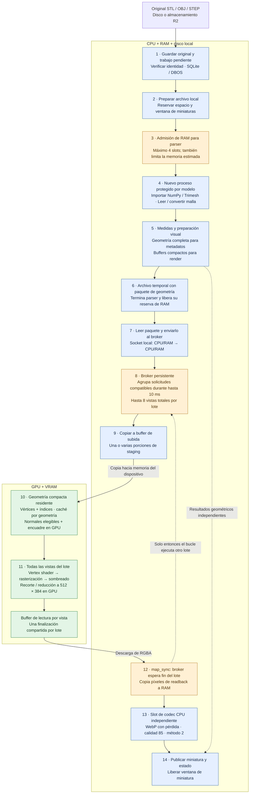
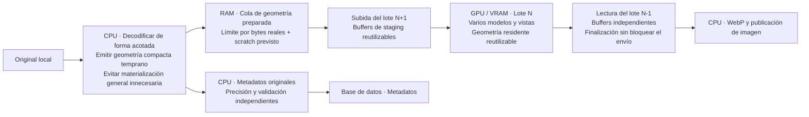

# Pipeline CPU/GPU de PrintStash: qué hace realmente y qué falta

Estado inspeccionado: runtime `d63a6af2`, diagnóstico `cc128ab5`, WSL como usuario Linux `local`. Este documento describe el código actual; el segundo diagrama es una propuesta, todavía no implementada.

**La GPU puede mantener varios modelos en VRAM y procesar muchas vistas sin una espera de CPU entre cada vista. Los límites actuales de PrintStash son decisiones de software.** El renderer ya agrupa vistas, pero recibe pocos modelos preparados y espera la descarga de un lote antes de ejecutar el siguiente. Por eso acelerar únicamente el dibujo no garantiza acelerar toda la importación.

## 1. Pipeline actual

El diagrama representa la ruta de miniaturas con GPU disponible. Las rutas de rechazo, fuentes inválidas, previsualizaciones incrustadas y recuperación por CPU se resumen después.

**Las etapas pueden solaparse entre modelos:** un parser puede preparar B mientras la GPU dibuja A y el codec comprime una imagen anterior. Sin embargo, el propio bucle de ejecución del broker queda bloqueado en `map_sync`. Tener varios clientes conectados no equivale a tener varios lotes GPU en vuelo.

La miniatura de estas pruebas es **512×384**, pero el perfil conserva supersampling: **se dibuja internamente a 1024×768 (factor 2)** antes de reducir a 512×384. El postprocesado GPU reduce la imagen antes de descargarla cuando su comprobación de capacidad funciona. Si falla, hay una ruta de finalización CPU. WebP se codifica con Pillow/libwebp en CPU; no se usa un encoder GPU de WebP.

## 2. RAM, VRAM y «expandir el modelo»

Hay tres operaciones distintas:

1. **Interpretar el archivo.** STL, OBJ y STEP son formatos de origen, no necesariamente los buffers que espera un shader. Los lectores actuales se ejecutan en CPU. OBJ requiere interpretar texto e índices; STEP requiere convertir geometría CAD en triángulos. Es posible diseñar lectores GPU para casos concretos, especialmente datos binarios regulares, pero el código actual no los tiene.
2. **Materializar la representación del parser.** Trimesh/NumPy mantienen arrays, índices y datos auxiliares en RAM. Las medidas de la geometría original también se calculan en CPU. El tamaño en disco no es su consumo de memoria. Esta representación general tiene costes evitables para una simple miniatura; no es una obligación impuesta por la tarjeta gráfica.
3. **Construir los vértices que se dibujan.** En la ruta compacta actual se suben posiciones e índices. El vertex shader consulta los tres índices de cada cara y calcula su posición/normal para dibujar. No se necesita fabricar en RAM un gran buffer de triángulos completos con todos sus atributos por cada cámara. El cálculo de normales visuales elegibles, bounds de render, cámara, sombreado y rasterización ya ocurre en GPU. Mallas pequeñas y casos rechazados conservan preparación canónica de normales en CPU.

Mover solamente el destino final a VRAM no hace que un parser Python escriba allí sin copias. La mejora estructural consiste en **evitar construir representaciones CPU innecesarias**, emitir buffers compactos temprano y conservarlos en el dispositivo para reutilizarlos. La precisión de los metadatos originales no debe depender de la versión simplificada o `float32` que se usa para dibujar.

Fuentes: [carga STL y otros formatos](../../backend/app/modules/media/mesh_loading.py), [selección de geometría visual](../../backend/app/modules/media/mesh_render.py), [paquete binario](../../backend/app/modules/media/compute_geometry.py), [vertex shader y renderer](../../backend/app/modules/media/webgpu_render.py), [normales y subida compacta](../../backend/app/modules/media/gpu_compact.py), [encuadre GPU](../../backend/app/modules/media/gpu_views.py).

## 3. Sí se pueden dibujar varios modelos y capturar varias vistas

Tener diez aplicaciones gráficas abiertas es compatible con el funcionamiento de la GPU: el controlador programa trabajo de distintos contextos. No implica que sus diez cargas se ejecuten físicamente al mismo tiempo, pero **no hay una limitación de “un modelo por GPU”**.

PrintStash usa un dispositivo persistente y puede poner varias cámaras/modelos en una entrega de comandos. En el código actual, un lote permite **8 vistas totales**: por ejemplo, 8 modelos con una vista cada uno, o 2 modelos con cuatro vistas. Se reutilizan los attachments de color/profundidad entre pases; cada imagen se copia a su propio espacio de lectura antes de reutilizarlos. Se envía el lote completo con un `queue.submit` y se espera una vez al final.

Esto evita esperar entre cada vista, pero **los pases comparten attachments y están ordenados**: no son ocho renderizadores independientes ejecutándose a la vez. Tampoco existe todavía un anillo de lotes con buffers independientes que permita continuar enviando trabajo mientras llega la descarga anterior. El broker atiende el siguiente lote tras `map_sync`.

En la pasada actual de 250 fuentes se observaron **217 lotes de un modelo, 8 de dos y 1 de tres**: 236 vistas en 226 lotes. El 96 % de los lotes llevaba un único modelo. Estos contadores pertenecen a esa pasada, sin reinicio del broker.

Además, agrupar ocho modelos requiere que estén preparados a tiempo. La ventana de espera es de hasta **10 ms**, mientras que iniciar/importar/cargar un modelo cuesta segundos. La ventana de miniaturas tiene cuatro slots compartidos por preparación, render y codec. En la ruta de handoff medida, esos cuatro slots ya impiden acumular ocho modelos de una vista simultáneamente; y la admisión RAM suele dejar activos todavía menos parsers.

Más procesos gráficos no eliminan estos bloqueos anteriores a la GPU. Las acciones concretas son alimentar una cola de geometría preparada, permitir varias entregas pendientes y retirar resultados sin bloquear el envío. El paralelismo físico que finalmente consiga el dispositivo debe medirse; no se obtiene por contar procesos.

Fuentes: [agrupación del broker](../../backend/app/runtime/compute/broker.py), [admisión de un lote](../../backend/app/runtime/compute/dispatcher.py), [ejecución y descarga](../../backend/app/modules/media/webgpu_render.py), [custodia de miniaturas](../../backend/app/modules/media/thumbnail_handoff.py).

## 4. Qué significan realmente los límites

| Límite actual | Qué limita | Qué no significa |
|---|---|---|
| 48 MiB por paquete de geometría, con comprobaciones adicionales de tamaño canónico | Un modelo aceptado por el protocolo y su representación | No es la VRAM total ni la velocidad del bus |
| 1 GiB de presupuesto lógico del broker en estas pruebas | Geometría, buffers temporales y recursos contabilizados del dispositivo | No es toda la VRAM física de la tarjeta |
| Hasta 384 MiB / 4 slots para miniaturas en el host; también depende de la RAM restante | Geometría/píxeles vivos entre parser, broker y codec | No limita directamente el número de modelos que físicamente cabrían en VRAM |
| 4 slots nativos y aproximadamente 3.86 GiB de presupuesto en esta ejecución | Procesos de parser y sus reservas estimadas | Cuatro slots no garantizan cuatro parsers activos |
| Solicitud de complejidad desconocida reserva todo el pool nativo | Evitar iniciar varios parsers cuyo consumo no se conoce | No prueba que ese archivo realmente necesite toda esa RAM |
| 8 vistas por lote | Tamaño admitido por la implementación | No es un límite universal de las GPU |
| 1 slot de codec independiente | Concurrencia de compresión WebP en CPU | No impide que la GPU dibuje mientras se comprime |

El adaptador de la prueba reporta **8151 MiB**; la cifra debe verificarse contra la GPU que se quiera utilizar, en vez de deducirla del límite de 48 MiB. El pico físico observado de 1971 MiB incluye otras aplicaciones del host y no mide exclusivamente PrintStash.

Se puede aumentar el presupuesto de dispositivo y revisar el límite por modelo. Pero llenar VRAM no es el objetivo: hay que reducir el tiempo total. Para ampliar esos límites con fundamento necesitamos tamaños rechazados, ocupación de la cola preparada, desalojos de caché y memoria viva de cada lote. La relación entre el límite de 48 MiB y cada rechazo concreto no se ha demostrado todavía en este informe.

## 5. Qué dicen los tiempos

La ejecución GPU de 1000 fuentes tardó **3004.626 s UTC**, frente a **2253.508 s** de la GPU previamente optimizada. Las optimizaciones de codec, WebP con pérdida y tamaño 512×384 siguen presentes. El resultado actual es peor; no demuestra un aprovechamiento satisfactorio del sistema.

| Medición acumulada, con solapamiento | Tiempo observado | Lectura correcta |
|---|---:|---|
| Importación de Trimesh en nuevos procesos | 1503.987 s | Coste de CPU/proceso repetido por modelo |
| Carga de malla, incluyendo esas importaciones | 1745.648 s | No sumar ambas filas |
| Espera de admisión nativa | 2233.541 s | Tiempo acumulado de solicitantes, no tiempo de GPU |
| Ejecución del renderer por lotes | 39.270 s | Span observado por CPU; incluye trabajo anidado |
| Espera de map/fence GPU | 4.760 s | Parte del renderer, no un coste adicional independiente |
| Cola del codec | 51.128 s | Muy inferior al cuello de botella antiguo del codec |

Estas cifras no son porcentajes de utilización GPU ni una descomposición aditiva del tiempo total. Faltan timestamps GPU para atribuir tiempo preciso a shaders y transferencias. También hubo una pausa del planificador de 307.393 s monotónicos, cuya causa no está demostrada. La regresión completa no puede atribuirse solo a esa pausa.

Las pruebas controladas de **250 fuentes** comparan GPU anterior, GPU actual y GPU actual sin trazado detallado. No se repite CPU por petición del usuario. Resultados y limitaciones se mantienen en [el informe de rendimiento](compute-control-throughput.md).

## 6. Pipeline propuesto, aún no implementado

Los índices N−1, N y N+1 indican etapas que se pretende solapar entre lotes; no prometen simultaneidad física en todos los adaptadores. Antes de implementarlo hay que dimensionar explícitamente los recursos de cada lote en vuelo. La espera `map/fence` medida suma solo 4.760 s en la pasada de 1000: hacerla asíncrona por sí sola no explica ni elimina los minutos de preparación y coordinación. Su beneficio depende de conseguir primero una cola de trabajo lista.

Orden de trabajo propuesto:

1. **Reducir el coste de preparación.** Para formatos aptos, un lector acotado puede generar los buffers visuales sin arrancar toda la pila Trimesh/SciPy. Mantener aislamiento por fuente; un pool persistente de parsers requiere resolver estado residual, fallos y contención antes de adoptarlo.
2. **Separar las reservas por etapa.** Medir memoria necesaria de parseo, geometría lista y píxeles por separado. La cola de preparación no debería estar artificialmente atada a la duración del codec; tampoco hay que liberar un crédito mientras sus buffers siguen vivos.
3. **Mantener 2–3 lotes en vuelo**, con staging/readback independientes, finalización asíncrona y propiedad de buffers hasta que su fence termine. Agrupar por bytes y vistas, además de por número de modelos. Esto requiere cambios de arquitectura y pruebas de cancelación/recuperación; no está aplicado en el renderer actual.
4. **Ajustar VRAM y paquete a la carga real.** Ampliar presupuesto donde permita evitar rechazos o reutilizar geometría; medir throughput, cola y memoria. No asumir una mejora proporcional a la capacidad reservada.
5. **Validar con el mismo conjunto de 250**, conservando fidelidad de metadatos, calidad visual, errores y tiempos. Una sola pasada no separa cambios pequeños de variabilidad del host.

La objeción central es válida: el sistema puede aprovechar mejor la GPU. El código ya hace parte del trabajo visual allí, pero la preparación CPU, la admisión y la coordinación siguen determinando cuándo llega el siguiente modelo. El objetivo es cambiar esa alimentación y el solapamiento, no presentar esas restricciones como características del hardware.
