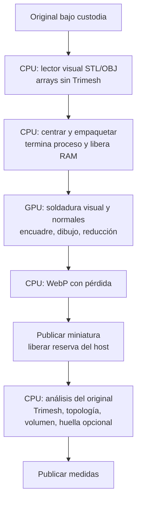

# Independent visual preparation

Runtime under measurement: `235c4524`. WSL, Linux user `local`.

STL/OBJ thumbnail-only requests load bounded vertex/index arrays without importing
Trimesh or SciPy. Float64 source coordinates are centred before converting visual
positions to float32. The persistent GPU performs visual welding and smooth-normal
preparation for eligible small inputs as well as large ones. It already performs
camera/bounds, vertex expansion, rasterization, shading and final downsampling.
CPU recovery remains available. Mesh thumbnail recipe is 16.

The existing durable mesh Job publishes the visual output first, releases the
parser and thumbnail host/codec reservation, then starts a separate measurement/
fingerprint process. The original is materialized once under source custody, but
STL/OBJ parsing happens in each path. Analysis retains its original precision and
Trimesh topology checks; this change does not claim GPU volume measurement. A
preview failure does not prevent analysis; an analysis failure cannot retract the
published preview. Cancellation and publication fences still stop stale work.

3MF retained-scene and STEP CAD conversion keep their established combined worker
path. Splitting STEP into two readers would duplicate tessellation. No schema or
JobKind is added. The visual-only path has no new service dependency.

The arrows describe sequencing for one Artifact. Other Artifacts may occupy the
parser, GPU and codec stages concurrently. This is computational separation within
the same Job, not two independently scheduled Job kinds. Broker multi-batch
readback overlap is not implemented by this change. The 48 MiB packet bound and
1 GiB broker budget are unchanged.

## Validation

Before: three import-blocking preview cases failed with `preview imported analysis:
trimesh`. After: all three render valid WebP without Trimesh/SciPy. The affected
media/derivative and repository hygiene selection passed **8088 tests**; additional
new focused cases and two STL/OBJ end-to-end cases passed. Ruff and Pyright passed.
An import-spacing lint failure was fixed in `db03f63d`; the batched-cancellation
E2E's old small-mesh CPU expectation was updated in `8bb5c040` and both cases
passed locally. Neither correction changes benchmark runtime `235c4524`.

## 250-source measurement

**The separated implementation is slower end to end.** It improves the visual
stage after a Job starts, but adds a second guarded process/read/admission for
241 STL/OBJ inputs. This is an architectural separation with a measured throughput
regression, not a successful overall GPU speed optimization.

The fixed selection is
`2780f43fa04318c7c8ebbc0b127e250f5887e0b3f4382f2d8800e4d72ccd3824`:
130 STL, 111 OBJ, 9 STEP. The run uses the existing immutable R2 corpus cache,
no R2 acquisition requests, four concurrent uploads, a 40-Artifact outstanding
window, 512×384 quality-85/method-2 WebP and the existing detailed observers.
CPU is not rerun. Historic GPU references and clock/host limitations remain in
[control throughput](compute-control-throughput.md).

| Measurement | Previous optimized GPU (`d63a6af2`) | Separate visual paths (`235c4524`) |
|---|---:|---:|
| Publication elapsed, UTC | 650.899 s | **766.257 s (+17.7%)** |
| Publication elapsed, WSL monotonic | 597.779 s | **700.374 s (+17.2%)** |
| Original hashes/sizes verified | 250 | 250 |
| Exact valid metadata outputs | 238 | 238 |
| Same invalid originals | 12 | 12 |
| Guarded executions | 250 | **491** |
| Supervision span, accumulated | 996.738 s | **1269.464 s** |
| Native admission wait, accumulated | 698.413 s | **1093.683 s** |
| Whole-native-pool claims | 53 | **88** |
| Mean active native slots | 1.67 | 1.81 |
| Mesh load phases, accumulated | 414.011 s | 429.231 s |
| Trimesh imports, accumulated | 332.967 s | 279.999 s (250 imports, analysis path) |
| Visual loader only, accumulated | Not separated | 86.990 s (241 calls; median 0.120 s) |
| GPU normal uploads | 49 | **232** |
| Device-rendered frames | 236 | 236 |
| Render batches | 226 | 223 |
| Renderer span, accumulated | 9.419 s | 9.308 s |
| Logical geometry upload bytes | 334,845,612 | 325,815,848 |
| Transfer span observed by host | 2.692 s | 2.104 s |
| Container CPU time | 1864.560 s | 2095.455 s |
| Container RAM peak | 1983.9 MiB | 2181.3 MiB |
| Thumbnail bytes, all valid outputs | 2,277,410 | 2,277,688 |

Spans overlap and must not be added as a decomposition of elapsed time. The new
load total includes both lightweight visual loading and original analysis. A lower
Trimesh import sum does not eliminate its 250 repeated imports. A source is
materialized once, but parsing/preflight/startup happen twice on the split route.
The control pool remains four slots; its byte budget blocks work even with free
slots. Native memory-block polls: 27,783; native lock wait/hold: 214.494/103.352
accumulated seconds; the codec queue remains only 6.749 accumulated seconds.
The observed regression is consistent with duplicated lifecycle/admission work;
a one-pass shared-host comparison does not isolate every contributing cause.

### Availability of previews

| UTC database interval, 238 valid previews | Previous median / p95 | Separate median / p95 |
|---|---:|---:|
| Derivative attempt created → thumbnail ready | 7.132 / 20.829 s | **4.306 / 15.314 s** |
| Original uploaded → thumbnail ready | 81.518 / 132.646 s | **99.379 / 140.813 s** |

All **229 valid STL/OBJ** previews now precede their own metadata publication,
with a median lead of **4.124 s**. Previously all 229 followed metadata (median
lag 1.278 s). That is real independent publication, but global queueing increases
because the containing Job still executes both paths sequentially. Earlier
publication within a running Job must not be reported as faster user-visible
availability across the full bulk queue.

### GPU, transfer, memory and integrity

The renderer used 212 single-model, 10 two-model and one four-model batch.
There were 233 prepared handoffs with zero handoff CPU recovery. The broker
completed 237 requests including one cache hit, corresponding to 236 rendered
frames; one other valid thumbnail used the remaining CPU route. The first four
inputs completed through GPU, with the full cold wave taking 13.537 s monotonic.
The renderer still waits on one batch at a time; aggregate map/fence wait was
1.037 s. Moving small visual normals increased device preparation coverage but
cannot compensate for hundreds of seconds in process/admission work.

Total observed geometry upload was 325.82 MB; completed broker output was
186.39 MB. The 2.104 s transfer counter combines host upload and readback/wait
latency; it is **not GPU timestamps or a measured PCIe bandwidth**. Observed local
socket send throughput was 90.83 MiB/s over 5.960 s inside send calls; reads were
10.58 MiB/s over 51.271 s, including waiting and 229 polling timeouts. These are
IPC measurements, not RAM→VRAM bus speeds. Detailed lock, transfer, process RAM,
CPU and concurrency distributions are in the sanitized JSON.

Physical adapter memory peaked at 1512 MiB of 8151 MiB reported; this includes
other host applications and is not exclusive PrintStash VRAM. Container swap and
OOM counters remained zero. The 48 MiB geometry protocol cap and 1 GiB logical
broker budget were unchanged. One packet-write refusal was observed; this run
does not establish that increasing the cap would address the dominant regression.

All 250 metadata rows match the historical baseline across all nine authoritative
fields; 238 contain valid geometry. Every original SHA-256/size matches. All 238
images are lossy WebP, 512×384 RGBA, with nonempty alpha, transparent corners and
clear borders. No R2 acquisition occurred; the source ledger is unchanged. The
benchmark container was stopped after verification. Image checks establish these
structural properties, not human perceptual approval or pixel identity.

### Limits and next bottleneck

The runtime image is
`sha256:857a98c9d671bf68255adadd2ae745905b77794a45a6de03be12cae890afc74e`,
built on the previous control image with the committed application source.
Dependencies, corpus order, upload window, render dimensions and codec policy are
retained. Instrumentation additionally observes the lightweight loader and
Derivative state transitions. This is one later run on a shared WSL host, not
randomized interleaved repetitions. UTC exceeded monotonic by 65.883 s; both
clocks show a regression. The longest observed Job-state gap was 17.994 s;
the former 307 s pause did not recur.

The remaining optimization must avoid duplicated startup/parsing while retaining
independent output ownership: for example, a validated reusable geometry handoff
or a separately admitted analysis execution architecture. Simply adding more GPU
normal work, more VRAM, or a second parser per original does not resolve it.
GPU topology/volume, binary source decoding in shaders, independently scheduled
visual/analysis Jobs and multiple GPU batches in flight are **not implemented**
by this patch.

[Full sanitized aggregates](compute-visual-250-summary.json) include historical
latency comparisons, exact metadata checks, clocks, host context and image audit.

## Coverage matrix

Paths are relative to `backend/tests/`. Requirements were enumerated before tests;
the following is the closing assessment of the new visual path.

| # | Behaviour (test name) | Category | Precondition / input | Observable outcome asserted | Tier | Status |
|---|---|---|---|---|---|---|
| 1 | renders without analysis dependencies | Happy | Binary/ASCII STL, OBJ; Trimesh/SciPy imports blocked | Nonempty WebP image, 128×96 | Integration | ✅ `integration/modules/media/thumbnail_engine/test_visual_dependencies.py::TestGenerate::test_renders_without_analysis_dependencies` |
| 2 | retains source coordinates | Happy | STL/OBJ; negative OBJ indices | Exact positions and indices | Integration | ✅ `integration/modules/media/test_visual_loading.py::TestLoadVisualMesh::test_retains_source_coordinates` |
| 3 | triangulates obj polygons | Happy | Quad and five-corner polygon | Expected oriented triangles | Integration | ✅ `integration/modules/media/test_visual_loading.py::TestLoadVisualMesh::test_triangulates_obj_polygons` |
| 4 | refuses invalid visual source | Error | Truncated/nonfinite STL; invalid OBJ coordinates/indices/faces; empty source | Typed refusal | Integration | ✅ `integration/modules/media/test_visual_loading.py::TestLoadVisualMesh::test_refuses_invalid_visual_source` |
| 5 | bounds visual allocation | Edge | STL/OBJ above face cap | Resource refusal | Integration | ✅ `integration/modules/media/test_visual_loading.py::TestLoadVisualMesh::test_bounds_visual_allocation` |
| 6 | bounds obj lines | Edge | Line above 64 KiB | Resource refusal | Integration | ✅ `integration/modules/media/test_visual_loading.py::TestLoadVisualMesh::test_bounds_obj_lines` |
| 7 | reports unavailable source | Error | Missing source | source_unavailable | Integration | ✅ `integration/modules/media/test_visual_loading.py::TestLoadVisualMesh::test_reports_unavailable_source` |
| 8 | reads continued obj faces | Edge | Backslash continuation | Complete face indices | Integration | ✅ `integration/modules/media/test_visual_loading.py::TestLoadVisualMesh::test_reads_continued_obj_faces` |
| 9 | bounds source bytes | Edge | Source above configured byte cap | Resource refusal | Integration | ✅ `integration/modules/media/test_visual_loading.py::TestLoadVisualMesh::test_bounds_source_bytes` |
| 10 | publishes outputs independently | Edge | Both paths succeed, analysis fails, preview fails | Thumbnail terminal before analysis; independent durable states | Integration | ✅ `integration/modules/derivatives/test_producers.py::TestIndependentMeshPaths::test_publishes_outputs_independently` |
| 11 | preserves cancellation | Error | Visual worker withdrawn | Cancellation propagates; analysis not started | Integration | ✅ `integration/modules/derivatives/test_producers.py::TestIndependentMeshPaths::test_preserves_cancellation` |
| 12 | releases visual host memory before analysis | Edge | Prepared frame under host credit | Frame released before credit; analysis starts after release | Integration | ✅ `integration/modules/derivatives/test_producers.py::TestIndependentMeshPaths::test_releases_visual_host_memory_before_analysis` |
| 13 | small geometry roundtrips without cpu normals | Edge | One-face visual packet | Visual mode and geometry retained through binary wire | Integration | ✅ `integration/modules/media/test_gpu_normals.py::TestVisualRender::test_small_geometry_roundtrips_without_cpu_normals` |
| 14 | selects gpu before cpu normals | Edge | 1, 19999, 20000 faces; CPU normals forbidden | Unwelded GPU representation | Unit | ✅ `unit/modules/media/test_mesh_render.py::TestDeferredPreparation::test_selects_gpu_before_cpu_normals` |
| 15 | keeps cpu recovery canonical | Error | GPU unavailable | Canonical CPU representation | Unit | ✅ `unit/modules/media/test_mesh_render.py::TestDeferredPreparation::test_keeps_cpu_recovery_canonical` |
| 16 | retains full geometry with smaller previews | Happy | Real STL/OBJ uploads; width 512 | Original bytes, triangle count and complete lossy alpha-bearing thumbnail | E2E | ✅ `e2e/test_ingest.py::TestMetadata::test_retains_full_geometry_with_smaller_previews` |
| 17 | publishes the healthy member when a batched job is cancelled | Error | Small/large meshes sharing GPU fence; one Job cancelled | Cancelled output withheld; healthy image and original measurements published | E2E | ✅ `e2e/test_render_batch_publication.py::TestRenderBatchPublication::test_publishes_the_healthy_member_when_a_batched_job_is_cancelled` |

The batched-cancellation E2E now expects GPU visual preparation for both small
and large meshes, while retaining its assertions on cancelled/healthy outputs,
original bytes and exact source measurements. The former small-mesh canonical
expectation no longer describes the requested GPU policy.

The existing staged-publication tests now exercise the retained 3MF worker:
source custody, supersession, durable partial output, fingerprint continuation,
host expiry and publication failure keep their assertions. Their coverage is
retained in the [handoff matrix](compute-thumbnail-handoff-v2.md). The previous
codec, lossy WebP, resource controls and CPU recovery remain covered by their
existing matrices; none of those optimizations were removed.
